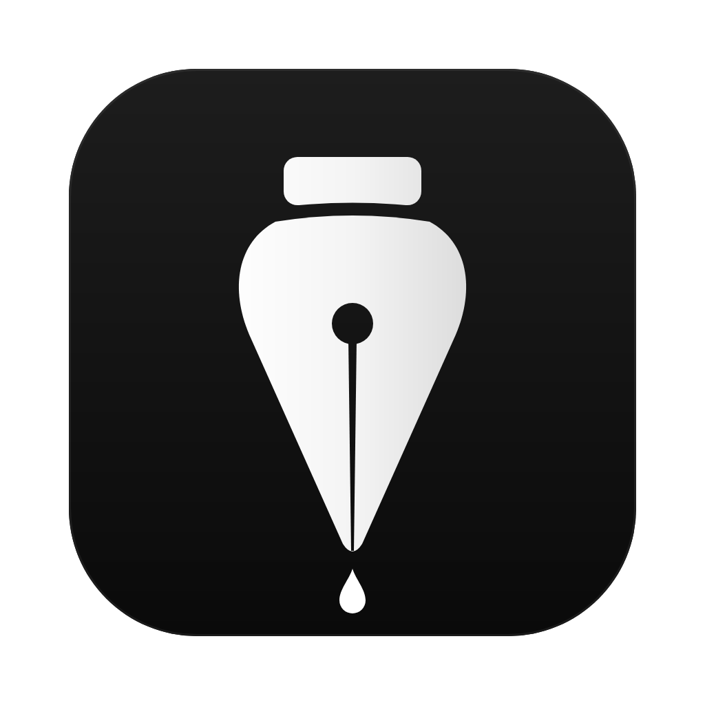

<p align="center"></p>

# Inkwell

An offline desktop reader for PDF articles, made for daily English reading practice.
It pulls clean text out of the PDFs and gives you a quiet reading view. You can highlight, save words with
their context, write what you understood under each paragraph, read in focus mode and keep a reading streak.

Runs on **macOS** and **Windows**. Works with no internet connection or account, and has no tracking.

> Unofficial. This project is not affiliated with any publisher or channel. It ships **no articles**:
> you read your own PDFs.

## Features

| | |
|---|---|
| **Library** | Search, filters (new / reading / done), progress, word counts. PDFs in the inbox folder are imported on start, or you can drag them onto the window |
| **Clean text** | Columns are put in reading order, and page numbers, headers and footers are removed. Scanned pages are OCR'd on device (Apple Vision on macOS, tesseract.js elsewhere) |
| **Highlights & vocabulary** | Select text, then `H` to highlight or `W` to save a word. The vocabulary panel (`V`) keeps the sentence each word came from and a field for your translation |
| **Paragraph notes** | Write what you understood under any paragraph (`N` in focus mode) |
| **Focus mode** (`F`) | One paragraph sharp in the middle, the rest dimmed |
| **Deep-focus session** (`S`) | A timer card with breaks. Every session is logged in the statistics |
| **Flashcards & test** | Review saved words. Paste a test and answer it beside the text |
| **AI export** | One shortcut copies the text, your notes and vocabulary as a ready prompt for any AI chat |
| **Statistics** | Streak, minutes, words read, goals |
| **Reminders** | Daily notifications at your usual reading time (launchd on macOS, Task Scheduler on Windows) |
| **Music** | A small background player for YouTube links you add |
| **Languages** | Uzbek, English, Russian interface |

macOS-only extras: **read-along** (`R`, which follows your voice with on-device speech recognition) and **desktop widgets**.

All shortcuts are listed, with a live demo, in **Settings → Shortcuts**. On Windows, read `⌘` as `Ctrl`.

## Install

### Windows
Download `Inkwell Setup x.y.z.exe` from [Releases](../../releases) and run it.
The installer isn't code-signed, so SmartScreen may warn you: choose *More info → Run anyway*.

### macOS
Download the `.dmg` from [Releases](../../releases). Or build it on your Mac (needs Node.js 20+ and the Xcode command line tools):

```bash
git clone https://github.com/Jonizz14/inkwell.git
cd inkwell
npm run install:mac
```

This builds the app with its native helpers (Vision OCR, read-along, reminders and widgets), puts it in `/Applications/Inkwell.app` and adds a Desktop shortcut.
The app isn't notarized. If macOS blocks a downloaded build, right-click it, choose *Open* and confirm.

## Adding articles
- Drop PDFs into the inbox folder: `~/Documents/Inkwell` (macOS) or `Documents\Inkwell` (Windows). They're imported every time the app starts.
- Drag PDFs onto the window, or use **+ Add PDF**.

## Your data
Everything stays on your computer:
- macOS: `~/Library/Application Support/365 Articles Reader/`
- Windows: `%APPDATA%\365 Articles Reader\`

`notes.json` holds your highlights, words, notes, progress and settings, so back up that file. `library/` holds the imported PDFs and the extracted text.

## Development

```bash
npm install
npm start               # run
npm test                # PDF extraction test
npm run build:mac-tools # macOS native helpers (optional)
npm run dist:mac        # .dmg
npm run dist:win        # Windows installer (build on Windows or in CI)
```

Layout:
- `src/main.js`: Electron main process (import, storage, IPC)
- `src/extract.mjs`: PDF → paragraphs (column detection, header and footer removal, OCR)
- `src/notify.js`: reminders and widget data
- `src/renderer/`: the interface
- `tools/`: Swift helpers for macOS

Every push to `main` builds the macOS and Windows installers in GitHub Actions and publishes them as a new release.

## License

[AGPL-3.0](LICENSE) © Javohir. You may use, study, change and share this code. If you distribute it,
or run a modified version for others over a network, you must publish your source under the same license.
The software comes with no warranty.

---

**O'zbekcha qisqacha:** PDF maqolalarni o'qish uchun oflayn ilova (Mac va Windows). Unda belgilash, lug'at,
abzas xulosalari, fokus rejimi, statistika va eslatmalar bor. Ilova bilan birga hech qanday maqola tarqatilmaydi,
PDF'larni o'zingiz qo'shasiz. Windows uchun `.exe` [Releases](../../releases) bo'limida.
